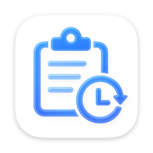

<p align="center">
  
</p>

# Clistory（历史粘贴板）

*Clipboard History for macOS · 英文名 Clistory · 中文名 历史粘贴板*

[简体中文](README.md) | [English](README_EN.md)

  [](LICENSE) [](https://github.com/qingke04/clipboard-history/releases/latest)

Clistory（中文名「历史粘贴板」）是一款 macOS 原生剪贴板历史管理工具：自动记录复制的文字与文件路径，支持搜索、置顶、回填和自动清理。应用常驻菜单栏，也可打开独立主窗口进行完整管理；界面支持跟随系统（Follow System）、简体中文与 English。当前版本 **1.1（Build 2）**。

## 功能特性

- **自动记录**：每 0.5 秒检测一次系统剪贴板；复制文字、富文本（仅保留纯文本）或文件/文件夹后自动生成记录，以 `.` 开头的隐藏文件会被过滤，连续复制相同文字不会重复记录。
- **文件只记路径**：文件与文件夹记录保存绝对路径，不复制文件本身，回填时始终使用源文件的最新内容。
- **跳过剪贴板图片**：截图、网页复制的图片等纯图片数据不进入历史；图片文件按普通文件记录路径。
- **搜索与排序**：输入即搜，匹配文字内容与文件名；列表按置顶优先、时间降序排列。
- **一键回填**：点击卡片即可将内容写回系统剪贴板；文件已被移动或删除时弹窗提示，确认后移除该条记录。
- **置顶与删除**：重要记录可置顶；删除只移除历史条目，不会删除源文件。
- **自动清理**：支持保留时长与条数上限两类规则，条数上限在新增记录时检查，保留时长在启动时及之后每小时检查；置顶记录不参与自动清理。
- **两种界面**：320 × 480 的菜单栏面板用于快速取用，680 × 480 的主窗口用于完整管理。
- **界面语言**：设置中可切换「跟随系统（Follow System，默认）」「简体中文」「English」；应用内文案即时切换，系统级文案在重启后完全生效。
- **全局快捷键**：默认 `⌘⇧V` 唤起面板，可在设置中录制新组合或恢复默认。
- **开机自启动**：基于 `SMAppService`，登录系统后自动在菜单栏运行。
- **动态 Dock 策略**：平时为纯菜单栏应用、不占用 Dock；打开主窗口或设置后显示 Dock 图标与菜单栏软件名，全部关闭后自动收回。
- **原生轻量**：SwiftUI + AppKit，无第三方依赖，数据全部留在本机。

## 系统要求

| 项目 | 要求 |
| --- | --- |
| 操作系统 | macOS 14 Sonoma 或更高版本 |
| 处理器 | Apple Silicon 或 Intel（发布包为通用二进制） |
| 构建环境 | Xcode 15+（Swift 5.9+），仅在从源码构建时需要 |

## 安装

### 使用 Homebrew（推荐）

通过 [Homebrew Tap](https://github.com/qingke04/homebrew-tap) 安装：

```bash
brew install --cask qingke04/tap/clistory
```

Homebrew 6 及以上会自动 tap 该仓库，并自动信任 `clistory` 这一个 cask（tap trust 机制）；旧版本 Homebrew 直接安装即可。

升级与卸载：

```bash
# 升级
brew upgrade --cask qingke04/tap/clistory

# 卸载（保留历史记录）
brew uninstall --cask qingke04/tap/clistory

# 卸载并删除历史记录
brew uninstall --zap --cask qingke04/tap/clistory
```

### 下载 DMG

从 [Releases](https://github.com/qingke04/clipboard-history/releases/latest) 下载最新安装包：

1. 下载 `Clistory-1.1.dmg` 并双击挂载。
2. 将 `Clistory.app` 拖入「应用程序」文件夹（中文系统下在访达中显示为「历史粘贴板」）。
3. 首次启动时，由于发布包使用 ad-hoc 签名且未经过 Apple 公证，Gatekeeper 可能提示无法验证开发者。请在「访达」中右键点击应用并选择「打开」，或前往「系统设置 → 隐私与安全性」点击「仍要打开」；放行一次后即可正常启动。

> Homebrew 安装的版本同样会在首次启动时遇到该 Gatekeeper 提示（Homebrew 会给下载的 app 打上 quarantine 标记），处理方式与上面第 3 步相同；也可以在终端执行 `xattr -dr com.apple.quarantine "/Applications/Clistory.app"` 放行。

可选：校验安装包完整性。

```bash
shasum -a 256 Clistory-1.1.dmg
# 将输出与对应 Release 说明中公布的 SHA-256 值比对
```

### 从 1.0.0 升级

1.1 起应用英文名改为 Clistory，安装包文件名由 `历史粘贴板.app` 变为 `Clistory.app`，因此升级后「应用程序」文件夹中可能同时存在旧版与新版本。升级请按以下步骤操作：

1. 安装新版本后，先运行一次 `Clistory.app`。
2. 打开「应用程序」文件夹，手动删除旧版本「历史粘贴板.app」。
3. 打开新版「设置 → 启动」，重新开启一次「开机自动启动」（关闭后再打开，使自启动指向新版本）。

> 两个版本使用相同的 Bundle ID（`com.clipboardmanager.app`）与数据目录，历史记录不会丢失，无需迁移。

## 使用方法

### 菜单栏面板

- 点击菜单栏的剪贴板图标展开面板，或按全局快捷键 `⌘⇧V` 唤出；面板失焦后自动关闭。
- 顶部搜索框实时过滤记录；列表优先显示「已置顶」分组，其余记录按时间降序排列。
- 点击卡片将内容复制到剪贴板，成功后显示绿色对勾；鼠标悬停在卡片上可执行置顶/取消置顶或删除。
- 底部工具栏显示记录总数，并提供「打开主界面」与「退出应用」按钮。

### 主窗口

点击面板底部的「打开主界面」按钮即可打开 680 × 480 的主窗口；应用启动时也会自动打开一次主窗口，关闭后仍继续常驻菜单栏。主窗口提供与面板一致的搜索和记录操作，并支持调整窗口尺寸。打开主窗口或设置后，应用会出现在 Dock 与菜单栏应用菜单中，从应用菜单选择「设置…」（`⌘,`）即可进入设置。

### 设置项

| 设置 | 可选值 / 说明 |
| --- | --- |
| 语言 | 跟随系统（Follow System，默认）/ 简体中文 / English |
| 存储时长 | 1 天 / 5 天 / 7 天 / 30 天 / 无限制 |
| 存储条数 | 10 / 20 / 50 / 100 / 200 条 / 无上限 |
| 快捷键 | 查看当前组合、录制新快捷键、恢复默认 |
| 启动 | 开机自动启动开关 |
| 关于 | 应用名称、版本与简介 |

### 语言设置

在「设置 → 语言」中切换界面语言，选项为「跟随系统（Follow System，默认）」「简体中文」「English」：

- 切换后若实际生效语言发生变化，会弹出重启提示框：
  - **立即重启**（默认选中，回车触发）：立即重启应用，应用内界面与系统级文案（应用菜单名、系统「设置…」菜单等）全部切换。
  - **稍后重启**：应用内界面立即切换；系统级文案在下次启动后完全切换。
- 若切换后实际生效语言没有变化（例如系统已是英文时选择 English），只保存设置，不弹出提示。

### 自动清理规则

- 默认设置：保留时长 1 天，存储条数无上限。
- 应用启动时执行一次过期清理，此后每小时执行一次。
- 每次新增记录时检查存储条数上限。
- 存储时长大于 0 时，删除超出时长的非置顶记录；选择「无限制」则不按时间清理。
- 存储条数大于 0 时，删除最旧的非置顶记录，直至非置顶记录数量不超过上限。
- 置顶记录不会被自动清理；删除历史记录不会删除对应的源文件。

## 数据与隐私

- **记录范围**：仅记录文字内容（富文本会提取为纯文本）与文件/文件夹的路径；不保存文件副本，不记录剪贴板中的图片数据。
- **存储位置**：历史记录以 JSON 编码保存在本机 UserDefaults 中（Bundle ID `com.clipboardmanager.app`，键 `clipboard_items`），通常对应 `~/Library/Preferences/com.clipboardmanager.app.plist`。
- **更名与数据不变**：英文名改为 Clistory 不改变 Bundle ID（仍为 `com.clipboardmanager.app`）与用户数据目录（仍为 `~/Library/Application Support/ClipboardManager/`），旧版本历史记录与新版本共用、无需迁移。
- **旧数据迁移**：早期版本使用的图片目录 `~/Library/Application Support/ClipboardManager/Images/` 会在升级后的首次启动时被清理。
- **完全离线**：应用不含网络请求代码，无第三方依赖或分析 SDK，不会上传任何数据。
- **路径提示**：文件记录保存完整的绝对路径，可能暴露用户名与目录结构，本版本不做路径脱敏。

## 从源码构建

项目为纯 SwiftUI/AppKit 工程，无第三方依赖，使用 Xcode 内置构建系统即可。

### 使用 Xcode

```bash
open Clistory/Clistory.xcodeproj
```

在 Xcode 中选择 `Clistory` Scheme 与 `My Mac` 目标，按 `⌘R` 运行，`⌘B` 构建。

### 使用命令行

首次使用命令行前，请先在 Xcode 中打开一次项目以生成 Scheme。以下命令在仓库根目录执行：

```bash
# Release 构建
xcodebuild \
  -project Clistory/Clistory.xcodeproj \
  -scheme Clistory \
  -configuration Release \
  -derivedDataPath build/DerivedData \
  build
```

构建产物位于 `build/DerivedData/Build/Products/Release/Clistory.app`。

如需通用二进制（arm64 + x86_64），在构建命令后追加 `ARCHS="arm64 x86_64" ONLY_ACTIVE_ARCH=NO`。

> 若本机 active developer directory 是 CommandLineTools，`xcodebuild` 会报 “requires Xcode”，可在命令前加 `DEVELOPER_DIR=/Applications/Xcode.app/Contents/Developer`。

如需归档分发：

```bash
xcodebuild \
  -project Clistory/Clistory.xcodeproj \
  -scheme Clistory \
  -configuration Release \
  -archivePath build/Clistory.xcarchive \
  archive
```

归档产物位于 `build/Clistory.xcarchive/Products/Applications/Clistory.app`，可继续用于打包 DMG，建议产物名为 `build/Clistory-1.1.dmg`。

## 项目结构

```text
.
├── Clistory/                          # Xcode 工程
│   ├── Clistory.xcodeproj/
│   └── Clistory/
│       ├── ClistoryApp.swift          # App 入口：MenuBarExtra / Window / Settings
│       ├── Info.plist
│       ├── AppIcon.icon/              # 应用图标源文件
│       ├── Assets.xcassets/
│       ├── App/                       # AppDelegate 系统集成
│       ├── Core/                      # 数据模型、监听、存储、快捷键、语言管理
│       ├── Services/                  # 剪贴板操作、窗口导航
│       ├── Resources/                 # en.lproj / zh-Hans.lproj 本地化字符串
│       └── UI/                        # 主窗口、菜单栏面板、设置与组件
├── build/                             # 构建产物（git 忽略）
├── docs/                              # 产品、技术、设计文档
├── dev-logs/                          # 开发日志与待办
├── PROJECT-OVERVIEW.md                # 项目全景
├── CLAUDE.md                          # 项目约定与索引
├── README.md                          # 中文版项目介绍、安装、使用、构建与许可证
├── README_EN.md                       # 英文版 README（Clip Once. Paste Anytime.）
└── LICENSE
```

## 文档索引

| 文档 | 内容 |
| --- | --- |
| [PROJECT-OVERVIEW.md](PROJECT-OVERVIEW.md) | 架构、模块职责、数据流、配置项与实现要点 |
| [docs/01-requirements.md](docs/01-requirements.md) | 产品定位、功能需求与功能边界 |
| [docs/02-technical-spec.md](docs/02-technical-spec.md) | 技术选型、数据模型、存储与剪贴板监听方案 |
| [docs/03-design-spec.md](docs/03-design-spec.md) | 界面布局、组件与交互规范 |
| [dev-logs/TODO.md](dev-logs/TODO.md) | 当前待办与已知问题 |
| [dev-logs/completed/](dev-logs/completed/) | 各阶段完成记录 |
| [README_EN.md](README_EN.md) | English README（英文版项目介绍） |
| [CLAUDE.md](CLAUDE.md) | 项目约定、目录结构与版本管理 |

## 已知限制

- **MenuBarExtra 右键菜单**：SwiftUI `MenuBarExtra` 暂不支持自定义右键菜单，因此设置入口位于应用菜单（`⌘,`），退出入口位于面板底部工具栏。
- **语言切换需重启**：切换语言后应用内文案即时生效，系统级文案（应用菜单名、系统「设置…」菜单等）需重启应用才完全切换。
- **未公证**：发布包采用 ad-hoc 签名，未使用开发者证书、未经过 Apple 公证，首次打开需要手动放行。
- **文件记录依赖源文件**：源文件被移动或删除后记录失效，应用会提示并自动删除对应条目。
- **不记录剪贴板图片数据**：截图等纯图片内容不会进入历史，这是当前版本的产品决策。
- **无路径隐私过滤**：文件记录保留完整路径，暂不提供脱敏或黑名单。
- **不支持云同步与富文本格式**：历史仅保存在本机；富文本只保留纯文本。

## 许可证

本项目基于 [MIT License](LICENSE) 开源，Copyright © 2026 qingke。
