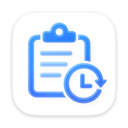

<p align="center">
  
</p>

# Clistory

*Clip Once. Paste Anytime.*

[English](README_EN.md) | [简体中文](README.md)

  [](LICENSE) [](https://github.com/qingke04/clistory/releases/latest)

**Clip Once. Paste Anytime.** Clistory is a native macOS clipboard history manager that automatically records copied text and file paths, with search, pinning, paste-back and automatic cleanup. It lives in the menu bar and can also open a standalone window for full management. The interface supports Follow System, Simplified Chinese and English. Current version: **1.1 (Build 2)**.

## Features

- **Automatic capture**: Checks the system clipboard every 0.5 seconds. Copied text, rich text (plain text only) and files/folders are recorded automatically; hidden files starting with `.` are filtered out, and consecutive identical text is not recorded twice.
- **Paths only for files**: File and folder entries store absolute paths instead of copying the files themselves, so pasting back always uses the latest content of the original files.
- **No clipboard images**: Pure image data (screenshots, images copied from web pages, etc.) is not added to history; image files are recorded as regular file paths.
- **Search and sorting**: Type to search; matches text content and file names. The list shows pinned items first, then newest first.
- **One-click paste-back**: Click a card to copy its content back to the system clipboard. If a file has been moved or deleted, a dialog appears and the entry is removed after confirmation.
- **Pin and delete**: Pin important entries; deleting only removes the history entry, never the source file.
- **Automatic cleanup**: Supports retention duration and item-count limits. The item limit is checked when new entries are added; the retention duration is checked at launch and every hour afterwards. Pinned entries are never cleaned up automatically.
- **Two interfaces**: A 320 × 480 menu bar panel for quick access, and a 680 × 480 main window for full management.
- **Interface language**: Switch between Follow System (default), Simplified Chinese and English in Settings. In-app text switches immediately; system-level text fully switches after a restart.
- **Global hotkey**: `⌘⇧V` opens the panel by default; record a new combination or reset to default in Settings.
- **Launch at login**: Powered by `SMAppService`; runs in the menu bar automatically after you log in.
- **Dynamic Dock policy**: Normally a pure menu bar app with no Dock icon; opening the main window or Settings shows the Dock icon and app menu name, and the Dock icon is hidden again after all such windows are closed.
- **Native and lightweight**: SwiftUI + AppKit, no third-party dependencies, and all data stays on your Mac.

## Requirements

| Item | Requirement |
| --- | --- |
| Operating system | macOS 14 Sonoma or later |
| Processor | Apple Silicon or Intel (release builds are universal binaries) |
| Build environment | Xcode 15+ (Swift 5.9+), only needed when building from source |

## Installation

### Homebrew (recommended)

Install from the [Homebrew Tap](https://github.com/qingke04/homebrew-tap):

```bash
brew install --cask qingke04/tap/clistory
```

Homebrew 6 and later automatically taps the repository and trusts only the `clistory` cask (tap trust mechanism); older Homebrew versions can install it directly.

Upgrade and uninstall:

```bash
# Upgrade
brew upgrade --cask qingke04/tap/clistory

# Uninstall (keep history)
brew uninstall --cask qingke04/tap/clistory

# Uninstall and remove history
brew uninstall --zap --cask qingke04/tap/clistory
```

### Download the DMG

Download the latest installer from [Releases](https://github.com/qingke04/clistory/releases/latest):

1. Download `Clistory-1.1.dmg` and double-click to mount it.
2. Drag `Clistory.app` into the Applications folder (on a Chinese system it appears as 「历史粘贴板」 in Finder).
3. On first launch, because release builds are ad-hoc signed and not notarized by Apple, Gatekeeper may warn that the developer cannot be verified. Right-click the app in Finder and choose Open, or go to System Settings → Privacy & Security and click Open Anyway. After allowing it once, the app launches normally.

> Versions installed via Homebrew also hit this Gatekeeper warning on first launch (Homebrew adds the quarantine attribute to downloaded apps). Handle it the same way as step 3 above, or run `xattr -dr com.apple.quarantine "/Applications/Clistory.app"` in Terminal.

Optionally verify the integrity of the installer:

```bash
shasum -a 256 Clistory-1.1.dmg
# Compare the output with the SHA-256 value published in the corresponding Release notes
```

### Upgrading from 1.0.0

Starting with 1.1, the English app name is Clistory and the bundle file name changed from `历史粘贴板.app` to `Clistory.app`. After upgrading, both versions may coexist in the Applications folder. Please follow these steps:

1. Install the new version and launch `Clistory.app` once.
2. Open the Applications folder and manually delete the old 「历史粘贴板.app」.
3. Open Settings → Launch in the new version and re-enable Launch at Login (turn it off and on again so it points to the new version).

> Both versions share the same Bundle ID (`com.clipboardmanager.app`) and data directory, so your history is preserved and no migration is needed.

## Usage

### Menu bar panel

- Click the clipboard icon in the menu bar to open the panel, or press the global hotkey `⌘⇧V`; the panel closes automatically when it loses focus.
- The search field at the top filters entries in real time; the list shows the Pinned group first, with all other entries sorted by time descending.
- Click a card to copy its content to the clipboard; a green check mark appears on success. Hover over a card to pin/unpin or delete it.
- The bottom toolbar shows the total number of entries and provides Open Main Window and Quit buttons.

### Main window

Click the Open Main Window button at the bottom of the panel to open the 680 × 480 main window; the app also opens it once at launch. The app keeps running in the menu bar after the window is closed. The main window offers the same search and entry operations as the panel and can be resized. When the main window or Settings is open, the app appears in the Dock and app menu; choose Settings… (`⌘,`) from the app menu to open Settings.

### Settings

| Setting | Options / notes |
| --- | --- |
| Language | Follow System (default) / Simplified Chinese / English |
| Storage duration | 1 day / 5 days / 7 days / 30 days / Unlimited |
| Item limit | 10 / 20 / 50 / 100 / 200 items / No limit |
| Hotkey | View the current combination, record a new shortcut, reset to default |
| Launch | Launch at login toggle |
| About | App name, version and description |

### Language settings

Switch the interface language in Settings → Language. The options are Follow System (default), Simplified Chinese and English:

- If the effective language actually changes, a restart prompt appears:
  - **Restart Now** (selected by default, triggered by Return): restarts the app immediately; both in-app text and system-level text (app menu name, the system Settings… menu item, etc.) switch.
  - **Restart Later**: in-app text switches immediately; system-level text switches fully on the next launch.
- If the effective language does not change (for example, choosing English when the system is already English), only the setting is saved and no prompt appears.

### Automatic cleanup rules

- Defaults: retention duration 1 day, no item limit.
- Expired entries are cleaned up once at launch and every hour afterwards.
- The item limit is checked whenever a new entry is added.
- When the retention duration is greater than 0, non-pinned entries older than that duration are deleted; choosing Unlimited disables time-based cleanup.
- When the item limit is greater than 0, the oldest non-pinned entries are deleted until the number of non-pinned entries no longer exceeds the limit.
- Pinned entries are never cleaned up automatically; deleting a history entry never deletes the corresponding source file.

## Data and privacy

- **What is recorded**: Only text content (rich text is reduced to plain text) and file/folder paths; no file copies are stored and clipboard image data is not recorded.
- **Storage location**: History is JSON-encoded and stored in local UserDefaults (Bundle ID `com.clipboardmanager.app`, key `clipboard_items`), usually corresponding to `~/Library/Preferences/com.clipboardmanager.app.plist`.
- **Rename without data changes**: Renaming the app to Clistory does not change the Bundle ID (still `com.clipboardmanager.app`) or the user data directory (still `~/Library/Application Support/ClipboardManager/`), so history from older versions is shared with new versions and requires no migration.
- **Legacy data migration**: The image directory used by early versions, `~/Library/Application Support/ClipboardManager/Images/`, is cleaned up on the first launch after upgrading.
- **Fully offline**: The app contains no networking code, no third-party dependencies or analytics SDKs, and uploads no data.
- **Path disclosure**: File entries store full absolute paths, which may reveal user names and directory structures; this version does not mask paths.

## Build from source

The project is a pure SwiftUI/AppKit project with no third-party dependencies and builds with Xcode's standard build system.

### Using Xcode

```bash
open Clistory/Clistory.xcodeproj
```

In Xcode, select the `Clistory` scheme and the `My Mac` destination, then press `⌘R` to run or `⌘B` to build.

### Using the command line

Before using the command line for the first time, open the project in Xcode once to generate the scheme. Run the following commands from the repository root:

```bash
# Release build
xcodebuild \
  -project Clistory/Clistory.xcodeproj \
  -scheme Clistory \
  -configuration Release \
  -derivedDataPath build/DerivedData \
  build
```

The build product is located at `build/DerivedData/Build/Products/Release/Clistory.app`.

For a universal binary (arm64 + x86_64), append `ARCHS="arm64 x86_64" ONLY_ACTIVE_ARCH=NO` to the build command.

> If the active developer directory on your machine is CommandLineTools, `xcodebuild` reports "requires Xcode"; prefix the command with `DEVELOPER_DIR=/Applications/Xcode.app/Contents/Developer`.

To archive for distribution:

```bash
xcodebuild \
  -project Clistory/Clistory.xcodeproj \
  -scheme Clistory \
  -configuration Release \
  -archivePath build/Clistory.xcarchive \
  archive
```

The archived product is located at `build/Clistory.xcarchive/Products/Applications/Clistory.app` and can be used to package the DMG; the suggested artifact name is `build/Clistory-1.1.dmg`.

## Project structure

```text
.
├── Clistory/                          # Xcode project
│   ├── Clistory.xcodeproj/
│   └── Clistory/
│       ├── ClistoryApp.swift          # App entry: MenuBarExtra / Window / Settings
│       ├── Info.plist
│       ├── AppIcon.icon/              # App icon source
│       ├── Assets.xcassets/
│       ├── App/                       # AppDelegate system integration
│       ├── Core/                      # Data model, monitoring, storage, hotkeys, language
│       ├── Services/                  # Clipboard actions, window navigation
│       ├── Resources/                 # en.lproj / zh-Hans.lproj localized strings
│       └── UI/                        # Main window, menu bar panel, settings, components
├── build/                             # Build artifacts (git-ignored)
├── docs/                              # Product, technical and design documents
├── dev-logs/                          # Development logs and TODOs
├── PROJECT-OVERVIEW.md                # Project overview
├── CLAUDE.md                          # Project conventions and index
├── README.md                          # Chinese README
├── README_EN.md                       # English README
└── LICENSE
```

## Documentation index

| Document | Content |
| --- | --- |
| [PROJECT-OVERVIEW.md](PROJECT-OVERVIEW.md) | Architecture, module responsibilities, data flow, configuration and implementation notes |
| [docs/01-requirements.md](docs/01-requirements.md) | Product positioning, functional requirements and scope |
| [docs/02-technical-spec.md](docs/02-technical-spec.md) | Technology choices, data model, storage and clipboard monitoring |
| [docs/03-design-spec.md](docs/03-design-spec.md) | UI layout, components and interaction guidelines |
| [dev-logs/TODO.md](dev-logs/TODO.md) | Current TODOs and known issues |
| [dev-logs/completed/](dev-logs/completed/) | Completed phase records |
| [CLAUDE.md](CLAUDE.md) | Project conventions, directory structure and version management |

> The documentation above is primarily in Chinese.

## Known limitations

- **MenuBarExtra right-click menu**: SwiftUI `MenuBarExtra` does not support custom right-click menus yet, so Settings is available from the app menu (`⌘,`) and Quit is in the panel's bottom toolbar.
- **Language switch requires a restart**: In-app text switches immediately, but system-level text (app menu name, the system Settings… menu item, etc.) fully switches only after restarting the app.
- **Not notarized**: Release builds are ad-hoc signed, without a developer certificate or Apple notarization, so the first launch requires manual approval.
- **File entries depend on source files**: If a source file is moved or deleted, the entry becomes invalid; the app shows a prompt and removes the entry automatically.
- **No clipboard image data**: Pure images such as screenshots are not added to history; this is a product decision for the current version.
- **No path privacy filter**: File entries keep full paths; masking or blacklists are not provided yet.
- **No cloud sync or rich-text formatting**: History stays on your Mac; rich text is reduced to plain text.

## License

This project is open source under the [MIT License](LICENSE). Copyright © 2026 qingke.
